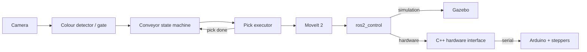

# ROS 2 SCARA Arm — Vision-Guided Conveyor Pick-and-Place

[](https://docs.ros.org/en/humble/)
[](https://moveit.picknik.ai/humble/)
[](https://gazebosim.org/docs/fortress)
[](#demo)

A 4-DOF SCARA arm that watches a conveyor, detects boxes of a chosen colour with a camera, picks them and drops them into colour bins. One ROS 2 stack drives both a Gazebo digital twin and the physical 3D-printed arm.

I built the robot software end to end — URDF from CAD, Gazebo world, controllers, MoveIt 2, a C++ hardware interface, Arduino firmware, perception and the conveyor logic — and then took it from simulation to hardware. The mechanical design is adapted from an open SCARA model ([credits](#credits)).

## Demo

<p align="center">
  <a href="https://www.youtube.com/shorts/4r_umrhB5zc"></a>
  <br><sub><b>Final autonomous demo on real hardware</b> — click to watch</sub>
</p>

- [Physical cell set up to mirror the simulation (LinkedIn, Part 23)](https://www.linkedin.com/posts/kumar-utkarsh-124aab227_robotics-ros2-digitaltwin-activity-7495491810367205376-1MMO)
- ["This robot picks any colour you ask it to"](https://www.youtube.com/shorts/ERg1EL5rM_c)
- LinkedIn build series: [Part 1: starting the project](https://www.linkedin.com/feed/update/urn:li:activity:7475813895127916544/) · [colour picking demo](https://www.linkedin.com/feed/update/urn:li:activity:7487813510979031041/) · [Part 25: final demo](https://www.linkedin.com/feed/update/urn:li:activity:7496081661785411584/)
- Full 25-part build log, from [Part 1: the plan](https://www.youtube.com/shorts/xwtNh44syTQ) to [Part 25: final demo](https://www.youtube.com/shorts/4r_umrhB5zc): [YouTube playlist: SCARA Robot Build (Parts 1–25)](https://www.youtube.com/playlist?list=PLFVs4BXGHW84) · [Instagram, Part 13](https://www.instagram.com/reel/DbRDdmOC3sn/) · [Instagram, showcase reel](https://www.instagram.com/reel/DcQOwcLMkKD/)

## Key features

- **Sim-to-real with one pipeline** — the simulated belt and the real webcam colour gate publish the same `/conveyor/box_at_pickup` event, so the cell's state machine runs unchanged on both.
- **Event-driven sorting cell** — keep one colour, let the rest ride past; latched QoS removes start-order races; a watchdog stops a failed pick from stalling the line.
- **MoveIt 2 (OMPL)** planning for an R-P-R-R arm (revolute column, lead-screw shoulder, revolute forearm and wrist) plus a two-finger gripper.
- **Custom C++ `ros2_control` hardware interface** streaming joint targets to an Arduino Uno + CNC Shield with a non-blocking BUSY/DONE serial handshake.
- **RGB-D colour picking** in simulation: HSV segmentation → pixel + depth → TF → IK → grasp.
- **Two-hand MediaPipe teleoperation** and **voice commands** (Whisper → Gemini → ElevenLabs).

## Hardware

| | |
|---|---|
| Arm | 3D-printed SCARA, 4 × NEMA 17 (column 19:1, 8 mm lead-screw shoulder, forearm 16:1, wrist 4.5:1), servo gripper |
| Electronics | Arduino Uno + CNC Shield V3, A4988 drivers, relay for the conveyor belt |
| Sensing | Fixed RGB-D camera (simulation), USB webcam above the belt (real cell) |

Wiring, calibration and the serial protocol: [`scara_firmware/docs/real_hardware.md`](scara_firmware/docs/real_hardware.md)

## How it fits together



## Software stack

ROS 2 Humble · MoveIt 2 · ros2_control · Gazebo Fortress (`ros_gz`) · pymoveit2 · OpenCV · MediaPipe · LibSerial · Arduino (AccelStepper) · Python · C++

## Packages

`scara_description` URDF, cameras, worlds · `scara_controller` controllers and slider tools · `scara_moveit` MoveIt config · `scara_firmware` hardware interface, Arduino sketch, bench GUI · `scara_vision` colour detection and hand teleop · `scara_conveyor` sorting cell ([details](scara_conveyor/README.md)) · `scara_voice` voice commands · `scara_bringup` launch files · `pymoveit2` vendored library

## Run

```bash
# build (Ubuntu 22.04, ROS 2 Humble)
mkdir -p ~/scara_ws/src && cd ~/scara_ws/src
git clone https://github.com/Curious-Utkarsh/scara-pick-and-place.git .
cd ~/scara_ws && rosdep install --from-paths src --ignore-src -r -y
colcon build --symlink-install && source install/setup.bash

# simulated conveyor cell — keep red boxes
ros2 launch scara_conveyor conveyor.launch.py
ros2 run scara_conveyor conveyor_pick_executor --ros-args -p target_color:=R

# real cell (arm parked at zero before power-on)
ros2 launch scara_bringup real_conveyor.launch.py serial_port:=/dev/ttyACM0
ros2 run scara_conveyor hardware_pick_executor --ros-args -p target_color:=R
```

If RViz or the MoveIt Setup Assistant fails to start after a recent Humble update, pin `rviz_common`: `sudo apt install ros-humble-rviz-common=11.2.27-1jammy.20260612.193221`

## Engineering notes

- **Velocity limits derived from the firmware.** Each real joint limit comes from its step cap and gear ratio (the shoulder tops out at 0.012 m/s, 42× slower than the simulated value); `joint_limits.yaml` keeps sim and real values side by side.
- **Blind pick on hardware, by design.** The gate stops every box under the camera centre, so the real pick uses a fixed IK pose; looking during the grasp would fail anyway because the arm covers the box.
- **Open loop, stated plainly.** There are no joint encoders yet: the arm must be parked at zero before power-on and a stalled motor goes unnoticed. AS5600 encoders and limit-switch homing are the next step.

## Related

- [MechaBot](https://github.com/MechaMind-Labs/AMR-Mastery) and [Mobi](https://github.com/Curious-Utkarsh/mobi-service-robot) — my mobile robots with the same hardware-interface pattern
- [Franka colour sorting](https://github.com/MechaMind-Labs/franka-color-sorting-robot) — the simulation-only predecessor of this vision pick pipeline
- [Dual-Panda tic-tac-toe](https://github.com/MechaMind-Labs/dual-franka-tic-tac-toe) — two simulated arms taking turns with MoveIt 2 and OpenCV
- [3-DOF arm digital twin](https://github.com/MechaMind-Labs/3dof-arm-digital-twin) — an earlier hardware-to-RViz/Gazebo twin

## Credits

Mechanical design adapted from an open SCARA model on [Cults3D](https://cults3d.com/en/3d-model/gadget/scara-robot-arm), with the HowToMechatronics SCARA as reference. [`pymoveit2`](https://github.com/AndrejOrsula/pymoveit2) by Andrej Orsula (BSD-3-Clause) is vendored in `pymoveit2/`.

---
[Kumar Utkarsh](https://github.com/Curious-Utkarsh) · [LinkedIn](https://www.linkedin.com/in/kumar-utkarsh-124aab227/) · [MechaMind Labs](https://www.mechamindlabs.com/)
