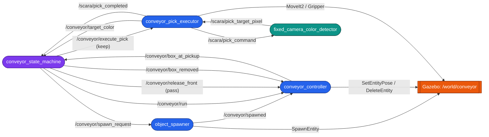
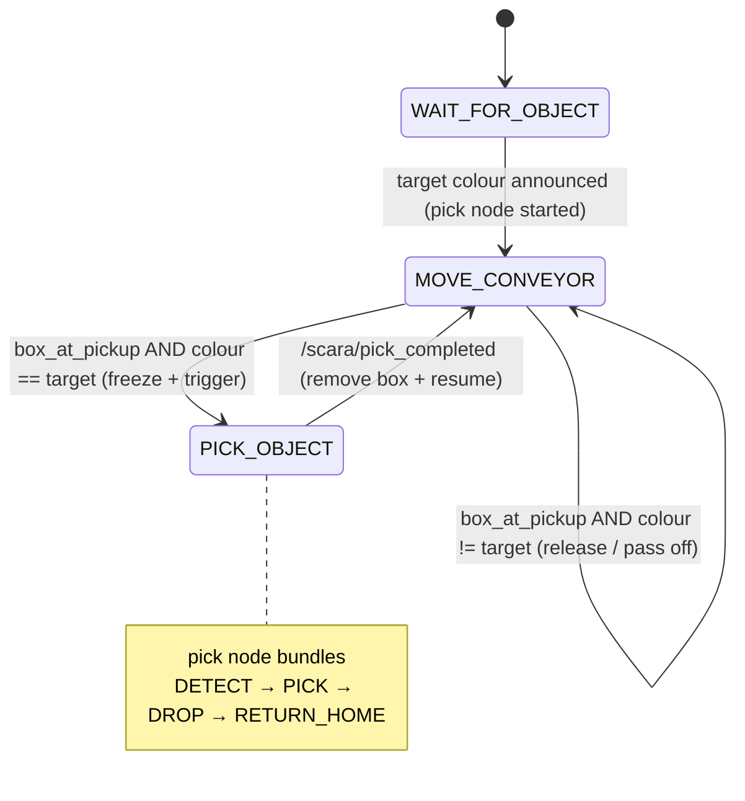

# scara_conveyor

Event-driven **conveyor pick-and-place** mini-project for the SCARA cell.

Boxes of random colour are spawned onto a conveyor that runs **along Y,
perpendicular** to the arm's reach and sits fully on the table. Each box advances
to the pickup point at the table centre and stops. You run the pick node
separately and tell it **one colour to keep**; that colour is picked and dropped
in its bin, while **every other colour rides past and drops off the far edge of
the table** — a colour-sorting line. One box at a time, in order, event-driven.

This package **adds** to the existing project; it does not modify any existing
node. It reuses the robot, controllers, MoveIt config, the fixed-camera colour
detector, and the pymoveit2 interface as-is.

## Operate it

```bash
ros2 launch scara_conveyor conveyor.launch.py          # belt idle, waiting
# in a second terminal — choose the colour to KEEP:
ros2 run scara_conveyor conveyor_pick_executor --ros-args -p target_color:=R
```

The belt stays idle until the pick node announces a colour. Then boxes flow:
red is picked into its bin, green/blue ride off the far edge and drop.

## Architecture



Purple = orchestrator, blue = new nodes, teal = reused node, orange = Gazebo.

## Nodes

| Node | Responsibility |
|------|----------------|
| `object_spawner` | On request, spawns one random R/G/B box (existing models) at the belt's near-edge tail via `SpawnEntity`, announces it on `/conveyor/spawned`. |
| `conveyor_controller` | Kinematic belt: teleports each tracked box along Y with `SetEntityPose`, queues them at `pickup + rank*spacing`, freezes on command, announces the settled front box, and removes boxes (picked, or passed off the far edge) with `DeleteEntity`. |
| `conveyor_pick_executor` | **Run separately** with `target_color`. Announces the colour, and on the state machine's trigger performs one pick of the box at the pickup point (detector pixel + depth + TF → IK → colour-bin drop), then emits `/scara/pick_completed`. |
| `conveyor_state_machine` | The orchestrator FSM. Waits for a target colour, feeds the belt, and per box decides **keep** (freeze + trigger pick) or **pass** (release to drop off). |
| `fixed_camera_color_detector` *(reused)* | Segments the target colour, publishes the box pixel on `/scara/pick_target_pixel`. |

## Topic & service flow

| Name | Type | From → To |
|------|------|-----------|
| `/conveyor/target_color` | `std_msgs/String` `R/G/B` (latched) | executor → state_machine |
| `/scara/pick_command` | `std_msgs/String` `R/G/B` (latched) | executor → detector |
| `/conveyor/spawn_request` | `std_msgs/Empty` | state_machine → spawner |
| `/conveyor/spawned` | `std_msgs/String` `name;color` | spawner → controller |
| `/conveyor/run` | `std_msgs/Bool` (latched) | state_machine → controller |
| `/conveyor/box_at_pickup` | `std_msgs/String` `name;color` | controller → state_machine |
| `/conveyor/execute_pick` | `std_msgs/String` `name;color` | state_machine → executor (keep) |
| `/conveyor/release_front` | `std_msgs/String` `name` | state_machine → controller (pass) |
| `/scara/pick_target_pixel` | `geometry_msgs/PointStamped` | detector → executor |
| `/scara/pick_completed` | `std_msgs/Bool` (latched) | executor → state_machine |
| `/conveyor/box_removed` | `std_msgs/String` `name` | state_machine → controller |
| `/world/conveyor/create` | `ros_gz_interfaces/srv/SpawnEntity` | spawner → Gazebo |
| `/world/conveyor/set_pose` | `ros_gz_interfaces/srv/SetEntityPose` | controller → Gazebo |
| `/world/conveyor/remove` | `ros_gz_interfaces/srv/DeleteEntity` | controller → Gazebo |

The three Gazebo services are exposed to ROS by a `ros_gz_bridge parameter_bridge`
started in the launch file.

## State machine



While `MOVE_CONVEYOR` is active a spawn timer (`spawn_period_s`, default 3 s)
keeps boxes flowing up to `max_on_belt` (default 3); they queue behind the front.

## Run

```bash
colcon build
source install/setup.bash
ros2 launch scara_conveyor conveyor.launch.py                       # belt idle
ros2 run scara_conveyor conveyor_pick_executor \                    # 2nd terminal
    --ros-args -p target_color:=R
```

The launch brings up Gazebo (conveyor world), controllers, MoveIt, the service
bridge, the detector, and the three conveyor nodes. Starting the pick node with
a colour begins the sort: that colour is picked into its bin, all others drop
off the far edge — indefinitely.

## Key geometry (tunable in `scara_conveyor/common.py` or via node params)

| Param | Default | Meaning |
|-------|---------|---------|
| `belt_x` | `0.35` | belt centre-line X (reachable + under camera, on table) |
| `spawn_y` | `-0.38` | near-edge tail where boxes are born |
| `pickup_y` | `-0.65` | belt stop / pick point (table centre) |
| `pass_end_y` | `-1.05` | drop-off point past the far table edge |
| `belt_z` | `0.3657` | proven box rest height on the table |
| `slot_spacing` | `0.12` | gap between queued boxes |
| `belt_speed` | `0.10` m/s | advance speed |
| `max_on_belt` | `3` | queue length cap |
| `spawn_period_s` | `3.0` | seconds between spawns |
| `pickup_xy_tolerance` | `0.08` | window that rejects non-front boxes |
| `target_color` | `R` | **(pick node)** colour to keep; all others pass |
