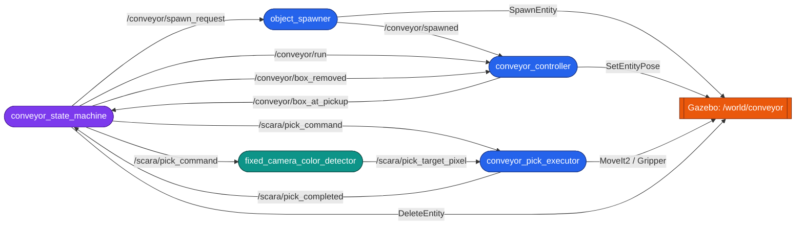
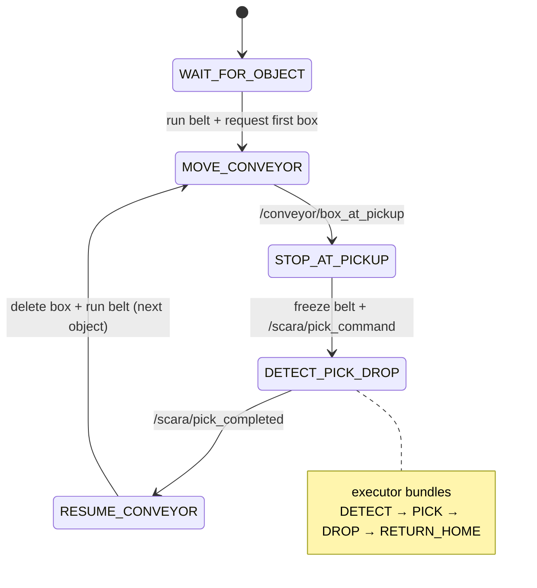

# scara_conveyor

Event-driven **conveyor pick-and-place** mini-project for the SCARA cell.

Boxes of random colour are spawned onto a conveyor, advance to a pickup point,
and stop. The fixed overhead camera detects the box, the SCARA picks it and
drops it in its colour bin, and only then does the belt resume and the next box
advance. Everything is synchronised by ROS events — no arbitrary sleeps except
the 1 Hz spawn cadence.

This package **adds** to the existing project; it does not modify any existing
node. It reuses the robot, controllers, MoveIt config, the fixed-camera colour
detector, and the pymoveit2 interface as-is.

## Architecture



Purple = orchestrator, blue = new nodes, teal = reused node, orange = Gazebo.

## Nodes

| Node | Responsibility |
|------|----------------|
| `object_spawner` | On request, spawns one random R/G/B box (existing models) at the belt tail via `SpawnEntity`, announces it on `/conveyor/spawned`. |
| `conveyor_controller` | Kinematic belt: teleports each tracked box forward with `SetEntityPose`, queues boxes at `pickup + rank*spacing`, freezes on command, announces the settled front box. |
| `conveyor_pick_executor` | Gated **single** pick: only the commanded colour, only a box at the pickup point (rejects queued boxes). Reuses the detector pixel + depth + TF → IK → pick → colour-bin drop, then emits `/scara/pick_completed`. |
| `conveyor_state_machine` | The orchestrator FSM. Feeds the belt, freezes it, commands the pick, removes the picked box, resumes. |
| `fixed_camera_color_detector` *(reused)* | Segments the commanded colour, publishes the box pixel on `/scara/pick_target_pixel`. |

## Topic & service flow

| Name | Type | From → To |
|------|------|-----------|
| `/conveyor/spawn_request` | `std_msgs/Empty` | state_machine → spawner |
| `/conveyor/spawned` | `std_msgs/String` `name;color` | spawner → controller |
| `/conveyor/run` | `std_msgs/Bool` | state_machine → controller |
| `/conveyor/box_at_pickup` | `std_msgs/String` `name;color` | controller → state_machine |
| `/conveyor/box_removed` | `std_msgs/String` `name` | state_machine → controller |
| `/scara/pick_command` | `std_msgs/String` `R/G/B` (latched) | state_machine → detector + executor |
| `/scara/pick_target_pixel` | `geometry_msgs/PointStamped` | detector → executor |
| `/scara/pick_completed` | `std_msgs/Bool` (latched) | executor → state_machine |
| `/world/conveyor/create` | `ros_gz_interfaces/srv/SpawnEntity` | spawner → Gazebo |
| `/world/conveyor/set_pose` | `ros_gz_interfaces/srv/SetEntityPose` | controller → Gazebo |
| `/world/conveyor/remove` | `ros_gz_interfaces/srv/DeleteEntity` | state_machine → Gazebo |

The three Gazebo services are exposed to ROS by a `ros_gz_bridge parameter_bridge`
started in the launch file.

## State machine



While `MOVE_CONVEYOR` is active a 1 Hz timer keeps spawning boxes up to
`max_on_belt` (default 3), so boxes queue naturally behind the front one.

## Run

```bash
colcon build
source install/setup.bash
ros2 launch scara_conveyor conveyor.launch.py
```

That single launch brings up Gazebo (conveyor world), controllers, MoveIt, the
service bridge, the detector, and the four conveyor nodes. Watch the belt fill,
stop, get picked, and resume — indefinitely.

## Key geometry (tunable in `scara_conveyor/common.py` or via node params)

| Param | Default | Meaning |
|-------|---------|---------|
| `pickup_x` | `0.40` | belt stop point (reachable + under camera) |
| `spawn_x` | `0.85` | belt tail where boxes are born |
| `belt_y` | `-0.65` | camera centre-line |
| `belt_z` | `0.3657` | proven box rest height on the table |
| `slot_spacing` | `0.14` | gap between queued boxes |
| `belt_speed` | `0.12` m/s | advance speed |
| `max_on_belt` | `3` | queue length cap |
| `pickup_xy_tolerance` | `0.08` | window that rejects non-front boxes |
